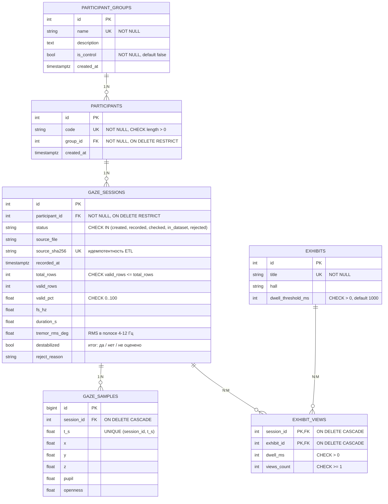

# ERD: VR-музей, стабилизация взгляда

Диаграмма на Mermaid (на GitHub отображается автоматически). Схема создаётся и меняется только
миграциями Alembic: `migrations/versions/c3f81d2a9b64_vr_gaze_domain.py`.

## Сущности

| Таблица | Назначение | Связи |
|---|---|---|
| `participant_groups` | группа участников (с нарушениями моторики, контрольная) | 1 : N участников |
| `participants` | участник записи, только код без персональных данных | 1 : N сессий |
| `gaze_sessions` | сессия записи взгляда, её качество и итог «дестабилизация: да/нет» | 1 : N отсчётов |
| `gaze_samples` | один отсчёт лога взгляда (строка CSV после очистки) | принадлежит сессии |
| `exhibits` | экспонат музея с порогом dwell-click | N : M с сессиями |
| `exhibit_views` | ассоциативная таблица: сколько взгляд удерживался на экспонате в сессии | связывает сессии и экспонаты |

## Индексы

- уникальные индексы по `participant_groups.name`, `participants.code`, `exhibits.title`;
- `participants.group_id`, `gaze_sessions.participant_id`, `gaze_sessions.status`: фильтрация списков;
- `exhibit_views.exhibit_id`: аналитика по экспонатам; `gaze_samples (session_id, t_s)` уникален и
  одновременно служит индексом для выборки отсчётов сессии по порядку времени.
